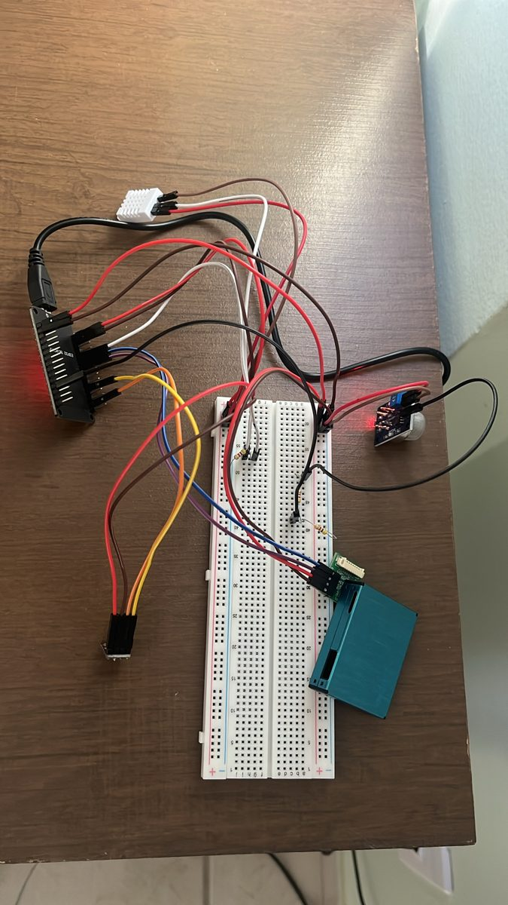
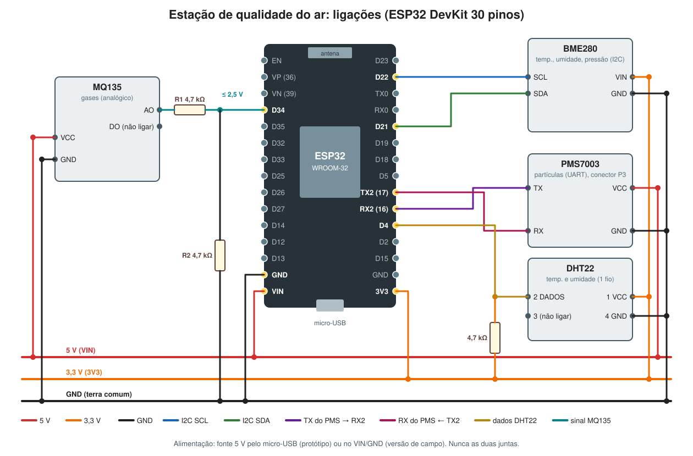
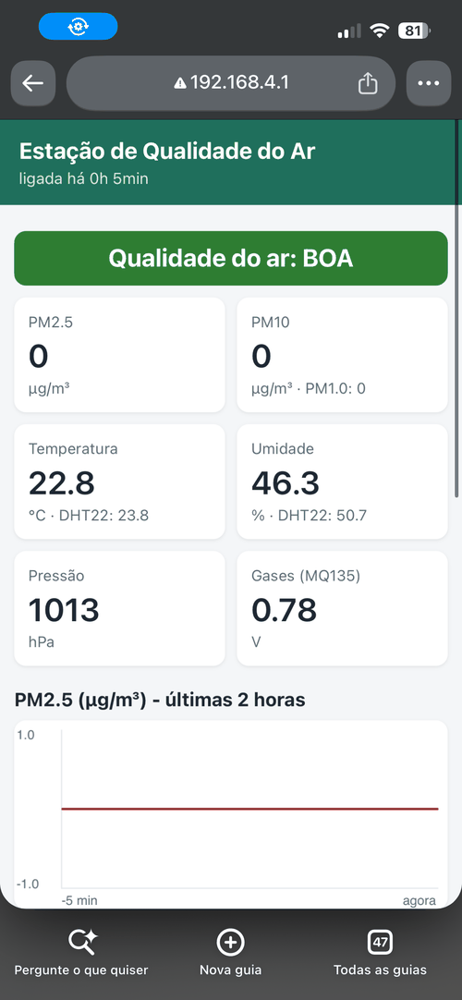
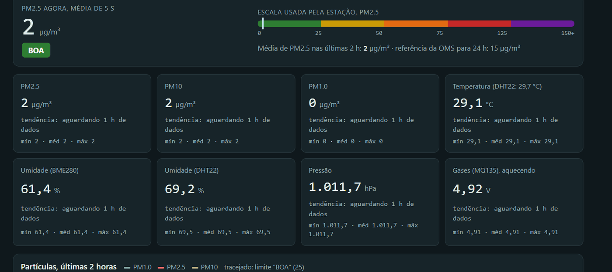

# Estação de Monitoramento da Qualidade do Ar

Estação de baixo custo baseada em **ESP32** que mede **partículas (PM1.0, PM2.5, PM10)**, **gases (MQ135)**,
**temperatura, umidade e pressão**, mostra tudo numa página Wi-Fi própria e envia a cada 20 s para o **ThingSpeak**.

**📊 Painel ao vivo: https://morfe0z.github.io/estacao_ar/**

| Protótipo funcionando | Diagrama de ligações |
|---|---|
|  |  |

## O que a estação mede

| Sensor | Mede | Ligação | Pino(s) no ESP32 |
|---|---|---|---|
| **PMS7003** | PM1.0, PM2.5, PM10 (µg/m³) | UART | RX2 / GPIO16, TX2 / GPIO17, 5 V |
| **MQ135** | gases (índice relativo, em volts) | analógica, com divisor 4,7 k / 4,7 k | GPIO34, 5 V |
| **BME280** | temperatura, umidade, pressão (referência) | I2C (0x76) | SDA / GPIO21, SCL / GPIO22, 3,3 V |
| **DHT22** | temperatura e umidade (segunda opinião) | 1 fio + pull-up 4,7 k | GPIO4, 3,3 V |

Detalhes em [hardware/ligacoes.md](hardware/ligacoes.md) e [hardware/lista-de-materiais.md](hardware/lista-de-materiais.md).

## Situação do projeto (novembro de 2026)

| Parte | Situação |
|---|---|
| Protótipo na protoboard, 4 sensores (Etapas 1–8) | ✅ funcionando |
| Página Wi-Fi própria + ThingSpeak (Etapa 9) | ✅ funcionando |
| Versão de campo robusta, com fila e recuperação automática (Etapa 10b) | ✅ em uso desde 09/10/2026 |
| Painel público (GitHub Pages) | ✅ no ar |
| Calibração do MQ135 (Etapa 11) | ⏳ a fazer |
| Placa soldada / PCB no KiCad | ⏸️ pausada (produto inicial usa placa expansora) ([docs/kicad](docs/kicad/)) |
| Estrutura externa (caixa IP65, abrigo impresso em 3D, "U" de PVC) | 🛠️ em projeto ([docs/estrutura-externa.md](docs/estrutura-externa.md)) |
| Produto físico acabado (etapas P0–P9) | 🛠️ P1 medidas; P2 nova fase: placa expansora + anemômetro, direção do vento e pluviômetro ([docs/produto](docs/produto/)) |

## Passo a passo da montagem

Cada etapa liga **um sensor por vez** e só avança depois de testar. Siga na ordem:

| # | Etapa | Programa |
|---|---|---|
| 1 | [Inventário e identificação das peças](docs/etapas/etapa-01-inventario.md) | — |
| 2 | [Mapa de ligações](docs/etapas/etapa-02-mapa-de-ligacoes.md) | — |
| 3 | [Arduino IDE e teste do ESP32](docs/etapas/etapa-03-arduino-ide-e-teste-esp32.md) | [etapa03_teste_esp32](firmware/etapa03_teste_esp32/) |
| 4 | [DHT22](docs/etapas/etapa-04-dht22.md) | [etapa04_dht22](firmware/etapa04_dht22/) |
| 5 | [BMP280 / BME280](docs/etapas/etapa-05-bmp280.md) | [etapa05_bmp280](firmware/etapa05_bmp280/), [etapa05b_bme280](firmware/etapa05b_bme280/) |
| 6 | [PMS7003](docs/etapas/etapa-06-pms7003.md) | [etapa06_pms7003](firmware/etapa06_pms7003/) |
| 7 | [MQ135 com divisor de tensão](docs/etapas/etapa-07-mq135.md) | [etapa07_mq135](firmware/etapa07_mq135/) |
| 8 | [Estação integrada](docs/etapas/etapa-08-estacao-integrada.md) | [etapa08_estacao_integrada](firmware/etapa08_estacao_integrada/) |
| 9 | [Versão final: página Wi-Fi + ThingSpeak](docs/etapas/etapa-09-versao-final.md) | [estacao_final](firmware/estacao_final/) |
| 10 | [Alimentação e instalação](docs/etapas/etapa-10-alimentacao-e-instalacao.md) | — |
| 10b | [Versão de campo (robusta)](docs/etapas/etapa-10b-versao-de-campo.md) | [estacao_campo](firmware/estacao_campo/), [estacao_campo_redes](firmware/estacao_campo_redes/) |

Antes de gravar os programas com rede, leia [firmware/README.md](firmware/README.md): as senhas ficam num arquivo
`secrets.h` que **não** vai para o GitHub.

## Como a estação funciona

- [Explicação completa](docs/como-a-estacao-funciona.md): o que cada sensor mede, como conversa com o ESP32, energia e software.
- [Painel do ThingSpeak](docs/painel-thingspeak.md): como instalar o painel remoto.
- [Solução de problemas](docs/solucao-de-problemas.md): os problemas reais que apareceram e como foram resolvidos (inclusive o erro 400 de 09/10).
- [Preparar um computador Linux](docs/preparar-computador-linux.md) para gravar o ESP32.

## Organização do repositório

```
├── index.html            painel público (GitHub Pages)
├── docs/
│   ├── etapas/           passo a passo, etapa 1 a 10b
│   ├── kicad/            projeto da placa (em andamento)
│   └── ...               explicação, estrutura externa, painel, problemas
├── firmware/             programas do ESP32, um por etapa (+ secrets.exemplo.h)
├── hardware/             diagrama e tabela de ligações, lista de materiais
├── painel/               painel para instalar como plugin do ThingSpeak
├── fotos/                fotos da montagem e capturas dos testes
├── dados/                dados medidos (CSV exportado do ThingSpeak)
└── publicacoes/          relatório técnico do protótipo (PDF)
```

## Fotos e resultados

Capturas do Monitor Serial de cada etapa, da página no celular e do painel: [fotos/](fotos/).

| Página da estação no celular | Painel remoto |
|---|---|
|  |  |

## Relatório

[Relatório técnico do protótipo (PDF, 73 páginas)](publicacoes/estacao_qualidade_ar_prototipo.pdf): teoria, instalação do zero,
cada etapa com os dados reais e todos os códigos em apêndice.

## Próximos passos

1. Calibrar o MQ135 (Etapa 11).
2. Rede Wi-Fi definitiva no local de instalação, com troca de rede pela página.
3. Marcar as leituras de partículas com umidade acima de 85 %.
4. Atualização do programa pelo Wi-Fi (OTA) e cartão microSD opcional.
5. Placa soldada, caixa e abrigos; alguns dias de teste na caixa antes de instalar fora.
