# Fotos e capturas de tela

## Montagem
| Foto | O que mostra |
|---|---|
| 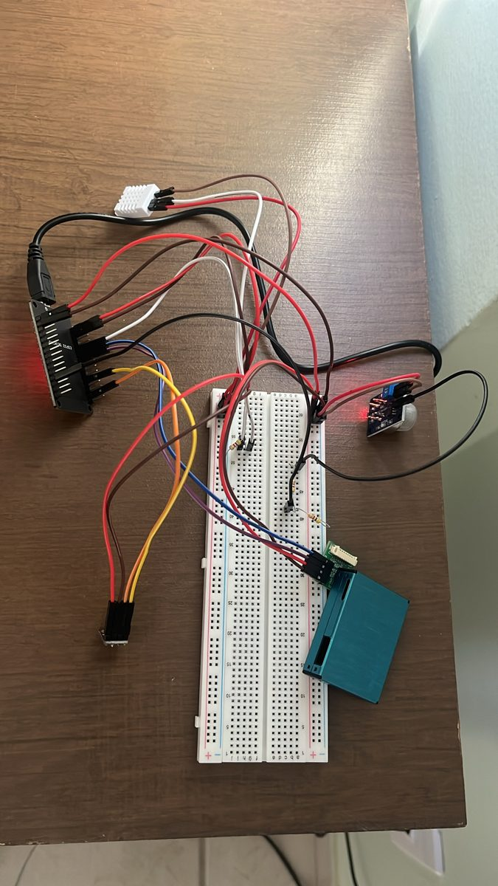 | Protótipo completo na protoboard, visto de cima: ESP32 (esquerda), DHT22 (branco, em cima), BME280 (embaixo à esquerda), MQ135 (direita, LED vermelho), PMS7003 (verde, embaixo) e os resistores do divisor e do pull-up |
| 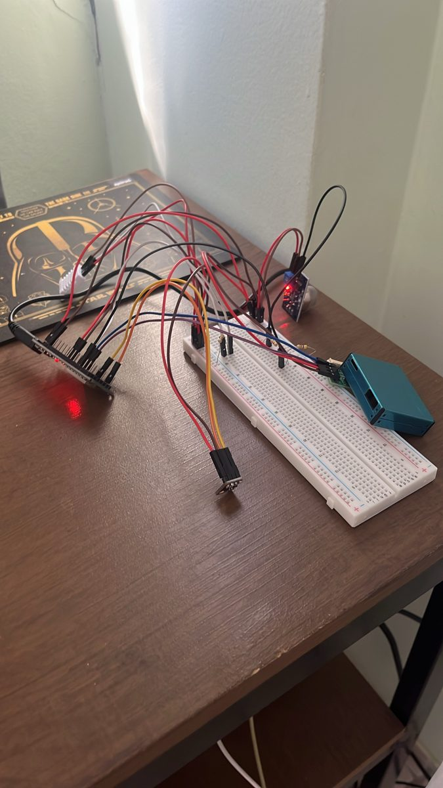 | O mesmo protótipo de lado, ligado e funcionando |
| 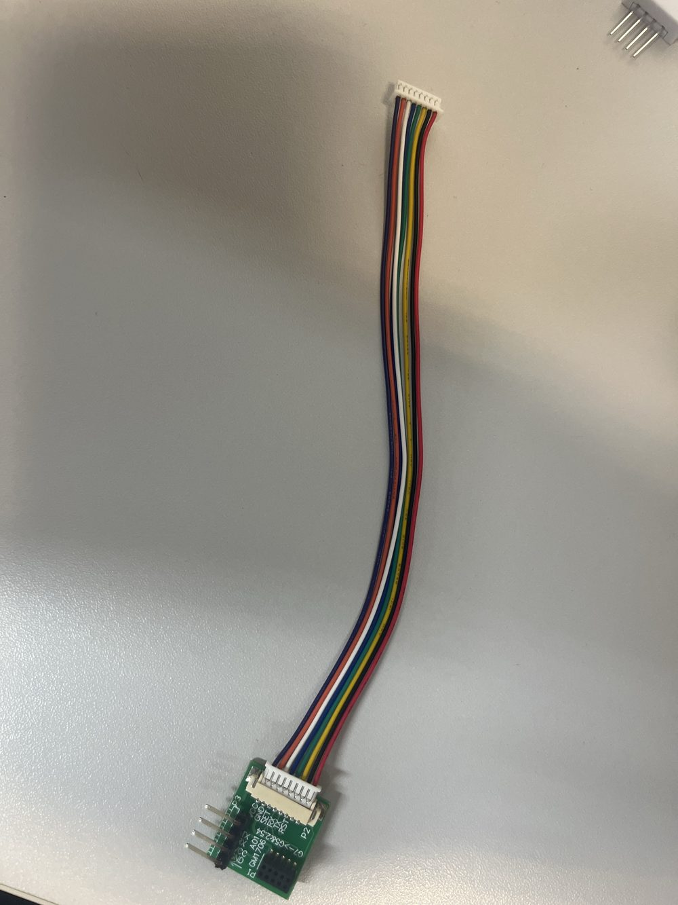 | PMS7003 com a placa adaptadora e o cabo |

<!-- Fotos da montagem completa entram aqui: protoboard com todos os sensores, detalhe do divisor do MQ135,
     estação ligada na fonte, e depois a placa soldada e a caixa. -->

## Resultados de cada etapa (Monitor Serial e páginas)
| Etapa | Captura |
|---|---|
| 3. ESP32 sozinho | 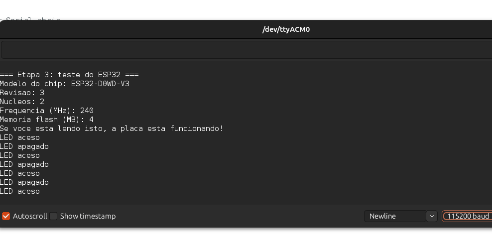 |
| 4. DHT22 | 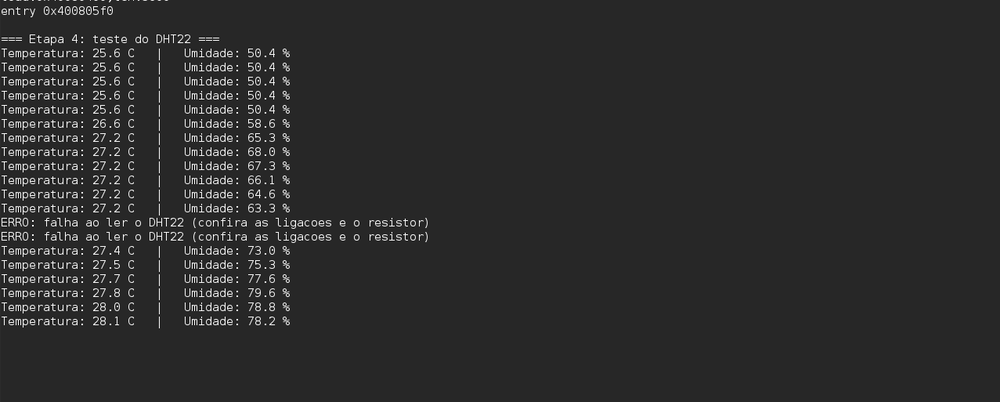 |
| 5. Sensor I2C identificado como BME280 (ID 0x60) | 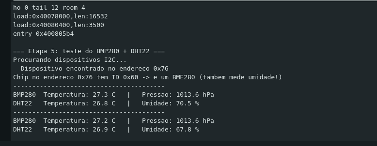 |
| 6. PMS7003 | 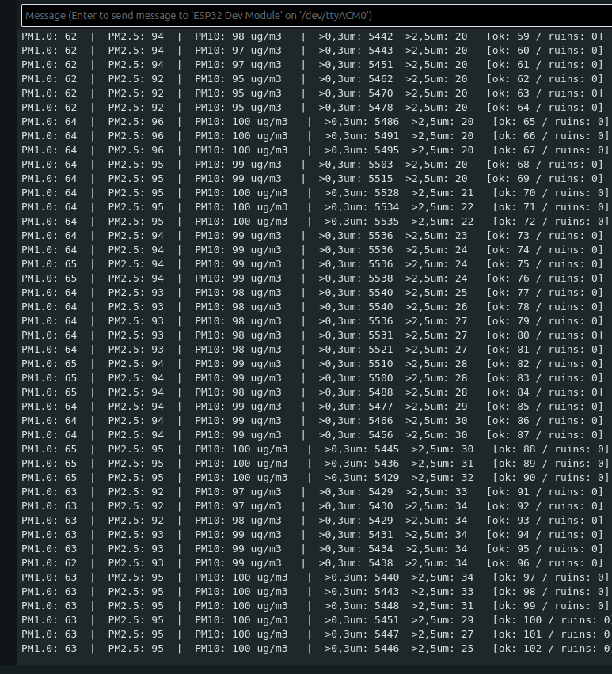 |
| 7. MQ135 aquecendo | 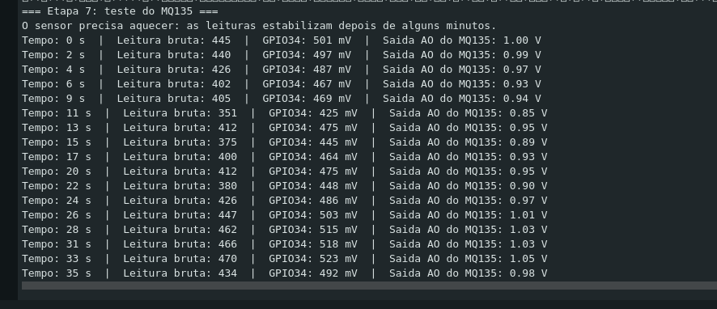 |
| 8. Estação integrada (com o teste de tirar o fio do PMS) | 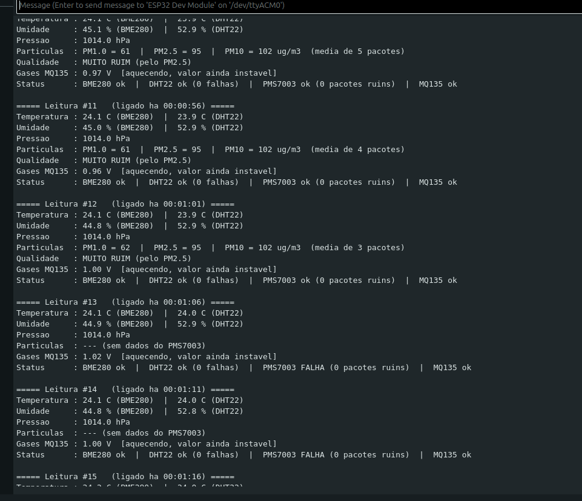 |
| 9. Página da estação no celular (http://192.168.4.1) | 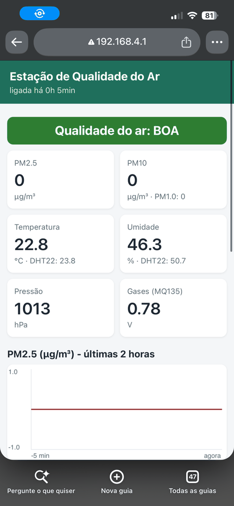 |
| 9. Erro 400 do ThingSpeak (incidente de 09/10, ver [solução de problemas](../docs/solucao-de-problemas.md)) | 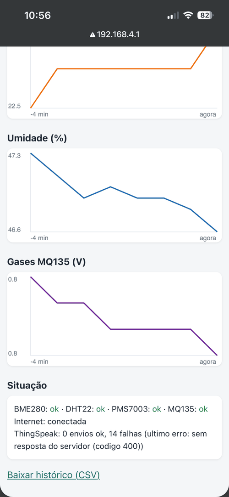 |
| Painel do ThingSpeak | 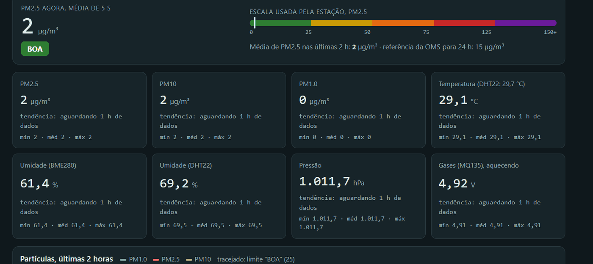 |
