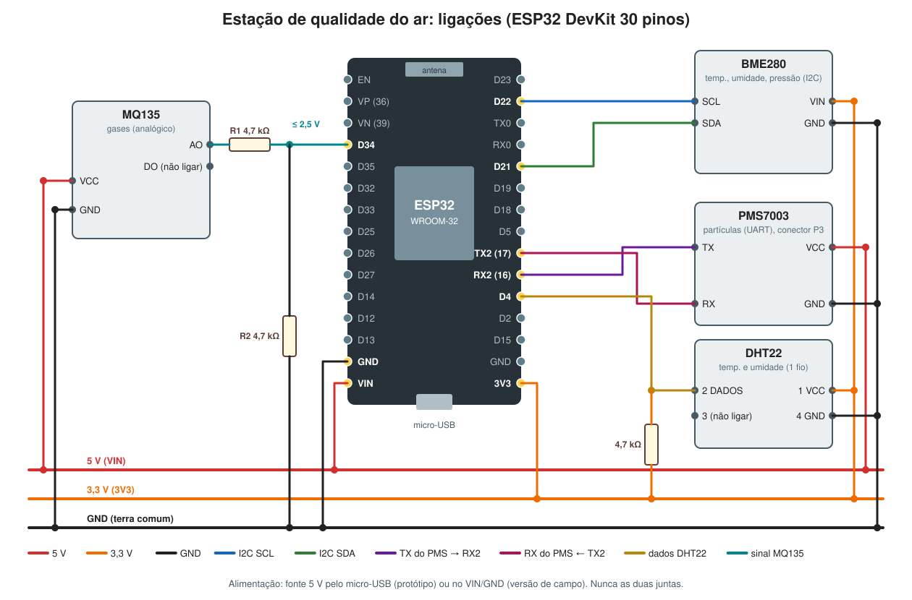

# Ligações da estação

Placa: **ESP32-WROOM-32 DevKit de 30 pinos** (chip USB CH343/CH9102, micro-USB).
Esta é a montagem testada na protoboard nas Etapas 4 a 9. O passo a passo, sensor por sensor, está em
[docs/etapas](../docs/etapas/).

## Tabela completa

| Sensor | Pino do sensor | Vai para | Observação |
|---|---|---|---|
| **BME280** (I2C, endereço 0x76) | VIN | **3V3** | |
| | GND | **GND** | |
| | SCL | **D22 / GPIO22** | |
| | SDA | **D21 / GPIO21** | |
| **DHT22** (sensor solto, grade virada para você) | 1 VCC | **3V3** | |
| | 2 DADOS | **D4 / GPIO4** | + resistor **4,7 kΩ** do DADOS para o 3V3 (pull-up) |
| | 3 | não ligar | |
| | 4 GND | **GND** | |
| **PMS7003** (adaptadora, conector **P3**: TX, RX, VCC, GND) | TX | **RX2 / GPIO16** | cruzado |
| | RX | **TX2 / GPIO17** | cruzado |
| | VCC | **VIN (5 V)** | a ventoinha precisa de 5 V |
| | GND | **GND** | |
| **MQ135** (módulo VCC/GND/DO/AO) | VCC | **VIN (5 V)** | o aquecedor precisa de 5 V |
| | GND | **GND** | |
| | AO | **divisor 4,7 kΩ / 4,7 kΩ**, ponto do meio no **D34 / GPIO34** | **nunca** direto no ESP32 |
| | DO | não ligar | |

## Por que esses pinos
- **GPIO34** é uma entrada analógica do ADC1, que continua funcionando com o Wi-Fi ligado (o ADC2 para de funcionar).
- O **divisor** corta a tensão do MQ135 pela metade: 5 V viram 2,5 V, abaixo do limite de 3,3 V do ESP32.
- Pinos evitados: **GPIO0, 2, 12, 15** (atrapalham a inicialização), **6 a 11** (memória interna), **1 e 3** (USB e Monitor Serial).
- **Terra comum é obrigatório**: todos os GND juntos.

## Alimentação
| Situação | Como ligar |
|---|---|
| Testes e protótipo | Fonte 5 V / 3 A com saída USB (ou o computador) no **micro-USB** do ESP32 |
| Versão de campo | Cabo **2 × 0,75 mm²** da fonte até a caixa, no **VIN** e **GND**, com capacitor 470 µF / 16 V perto da entrada |

⚠️ **Nunca** use a fonte no VIN e o USB ao mesmo tempo.

## Consumo aproximado
| Parte | Corrente |
|---|---|
| ESP32 com Wi-Fi | 100 a 250 mA (picos) |
| PMS7003 (ventoinha) | ~100 mA |
| MQ135 (aquecedor) | ~150 mA |
| BME280 + DHT22 | < 2 mA |
| **Total** | **~0,5 A**: a fonte de 3 A sobra |

## Próximo passo do hardware
A protoboard vai virar uma **placa soldada** (ou PCB fabricada, em projeto no KiCad, veja [docs/kicad](../docs/kicad/)),
dentro de uma caixa IP65, com os sensores em abrigos separados: [docs/estrutura-externa.md](../docs/estrutura-externa.md).
